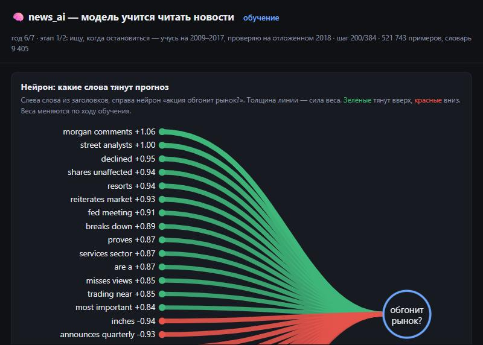
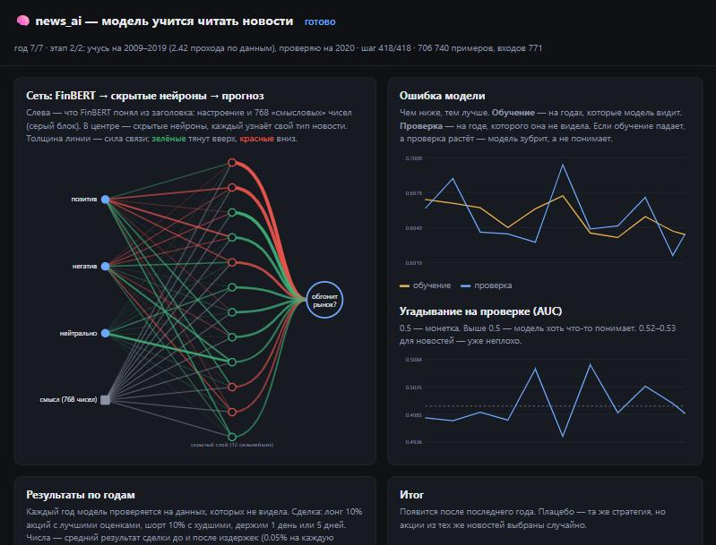

# news_ai — can a self-built AI trade on financial news?

🇬🇧 English · [🇩🇪 Deutsch](#-deutsch)

An end-to-end experiment: **2.4 million financial headlines**, a neural network
written **from scratch in NumPy**, strict "only learn from the past" testing, a
live training dashboard — and an honest answer at the end: **no, not after
trading costs.**



## What it does

1. **Data** — 1.4 M Benzinga headlines (2009–2020) and 1.05 M nasdaq.com
   headlines (2021–2023, FNSPID), matched to daily prices of ~2,500 US stocks.
   Every headline becomes a training example: *did the stock beat the market
   (SPY) after the news?*
2. **Level 1** — one neuron (logistic regression) with a weight per word and
   word pair, trained with mini-batch Adam. Pure NumPy, no ML libraries, so the
   dashboard can show every weight while it learns.
3. **Level 2** — FinBERT reads every headline on the GPU (493 k unique
   headlines in 5 minutes on an RTX 3050 Ti); a small network with a hidden
   layer learns on top of FinBERT's 768-number "meaning fingerprint".
4. **Dashboard** (`ui/index.html`) — train vs. test loss, AUC, results per
   year and the network itself: which words or hidden neurons push the
   prediction up (green) or down (red).



## How it is tested (no cheating)

- **Walk-forward:** train on 2009–2013, test on 2014; train on 2009–2014,
  test on 2015; … The model never sees the year it is tested on.
- **Early stopping on a held-out year** inside the training data — the test
  year is not used for any decision.
- **No look-ahead:** 96 % of headlines have only a date, so the trade enters at
  the *next day's* open.
- **Vocabulary from training years only**, and words used for fewer than 50
  companies are dropped (so the model can't just learn "Apple went up").
- **Placebo:** the same strategy with randomly chosen stocks from the same news.
- **Block bootstrap** for confidence intervals (overlapping 5-day trades are
  not independent).
- **Pre-registered exam** on 2021–2023, rules written into the code *before* the run.

Strategy: every day, long the 10 % of stocks with the best news score and short
the 10 % with the worst; hold 1 or 5 days; costs 0.05 % per side.

## Results

| test | 1 day, before → after costs | 5 days, before → after costs | verdict |
|---|---|---|---|
| Level 1 (words), 2014–2020 | +0.20 % → 0.00 % | +0.34 % → +0.14 % (95 % CI −0.005…+0.28) | real signal, ≈ costs |
| Level 1, large caps only | +0.08 % → −0.12 % | +0.22 % → +0.02 % | ≈ 0 |
| Level 2 (FinBERT), 2014–2020 | +0.05 % → −0.15 % | +0.15 % → −0.05 % | worse than words |
| **Exam A** 2021–23, model unchanged | +0.05 % → −0.15 % | +0.04 % → −0.16 % | ❌ failed |
| **Exam B** 2021–23, retrained on Nasdaq | 0.00 % → −0.20 % | +0.12 % → −0.08 % (CI −0.17…+0.04) | ❌ failed |

The model **does** read news better than chance — it beat 100 % of random
picks in every test year 2014–2020. But the edge is smaller than trading
costs, it shrank 4–8× on new years and a new news source, and it vanishes on
liquid large caps. FinBERT understands sentiment correctly (downgrades →
negative, FDA approval → positive), but the market has already priced that in
by the next open; the word model's edge came mostly from short-term *reversal*
("declined", "misses estimates" → the stock bounces).

Side test (`iphone_effect.py`): Apple beat the market by +4.8 % in the 30 days
before iPhone events (14 of 19), and fell on the event day 14 of 19 times —
a hint, not proof (6 windows tested, one passing at 95 % is expected by chance).

## Lessons learned

- yfinance can be **silently** blocked: it reports live tickers like AMZN as
  "possibly delisted". Fix: put known tickers (SPY, AAPL, IBM) into *every*
  batch as canaries.
- A capped helper silently truncated funding/price history in an earlier
  project — always check that "all the data" really is all the data.
- Overlapping trades make plain bootstrap intervals look falsely confident.
- A bigger model (FinBERT) is not automatically better than counting words.

## Run it

```bash
python -m venv .venv
.venv\Scripts\pip install yfinance pandas numpy            # level 1
.venv\Scripts\pip install torch --index-url https://download.pytorch.org/whl/cu126 transformers   # level 2
```

Data folder is set in `news.py` (`DATA`). Then: `panel.py` (prices) →
`start.bat` (dashboard + `train.py`), `embed.py` + `train.py --finbert` for
level 2, `exam.py` for the 2021–2023 exam. Data is not included: Benzinga
headlines (Kaggle/Hugging Face), [FNSPID](https://github.com/Zdong104/FNSPID_Financial_News_Dataset),
prices from Yahoo Finance.

Code comments are in Russian; notes in [docs/NOTES.ru.md](docs/NOTES.ru.md).

---

## 🇩🇪 Deutsch

**Kann eine selbst gebaute KI mit Finanznachrichten Geld verdienen?** Ein
Experiment von Anfang bis Ende: 2,4 Mio. Schlagzeilen, ein neuronales Netz von
Grund auf in NumPy, strenge Prüfung nur auf Jahren, die das Modell nie gesehen
hat, ein Live-Dashboard — und eine ehrliche Antwort: **nein, nicht nach
Handelskosten.**

- **Stufe 1:** ein Neuron mit einem Gewicht pro Wort, trainiert mit Adam.
- **Stufe 2:** FinBERT liest alle Schlagzeilen auf der GPU, darauf ein kleines
  Netz mit verdeckter Schicht.
- **Prüfung:** Walk-Forward (Training nur auf der Vergangenheit), Early Stopping
  auf einem zurückgehaltenen Jahr, Einstieg erst am nächsten Handelstag,
  Placebo-Vergleich, Block-Bootstrap, vorab festgelegte Prüfung 2021–2023.

**Ergebnis:** Das Modell liest Nachrichten besser als der Zufall (2014–2020 in
jedem Jahr besser als 100 % zufälliger Auswahl), aber der Vorteil ist kleiner
als die Handelskosten und verschwindet auf neuen Jahren (2021–2023) und bei
großen, liquiden Aktien. Die Prüfung wurde in beiden Varianten nicht bestanden.

**Gelernt:** Overfitting erkennen, Look-Ahead vermeiden, stilles Rate-Limiting
von Yahoo erkennen, saubere Konfidenzintervalle bei überlappenden Trades — und
dass ein größeres Modell nicht automatisch besser ist.
